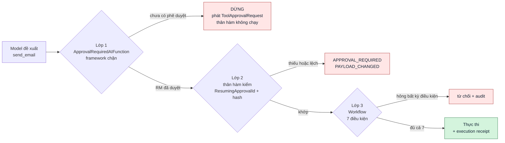
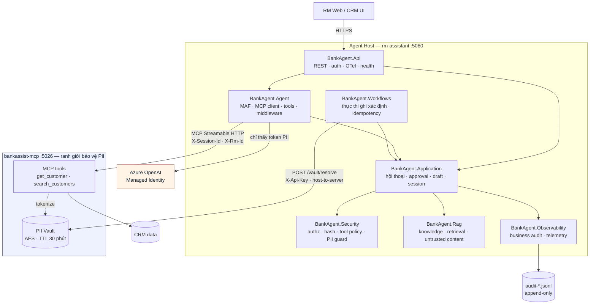
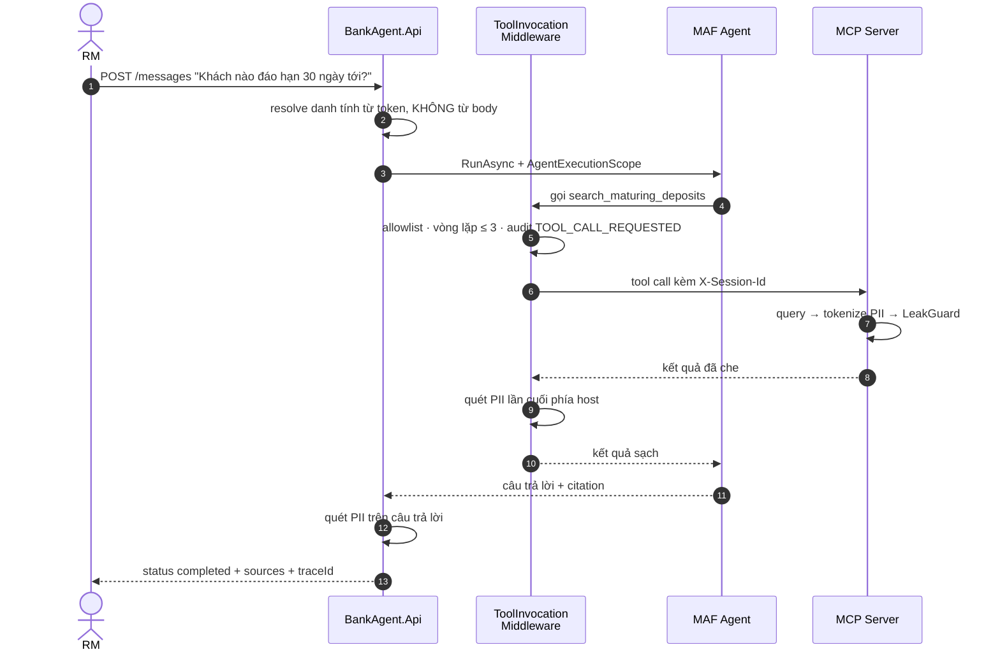
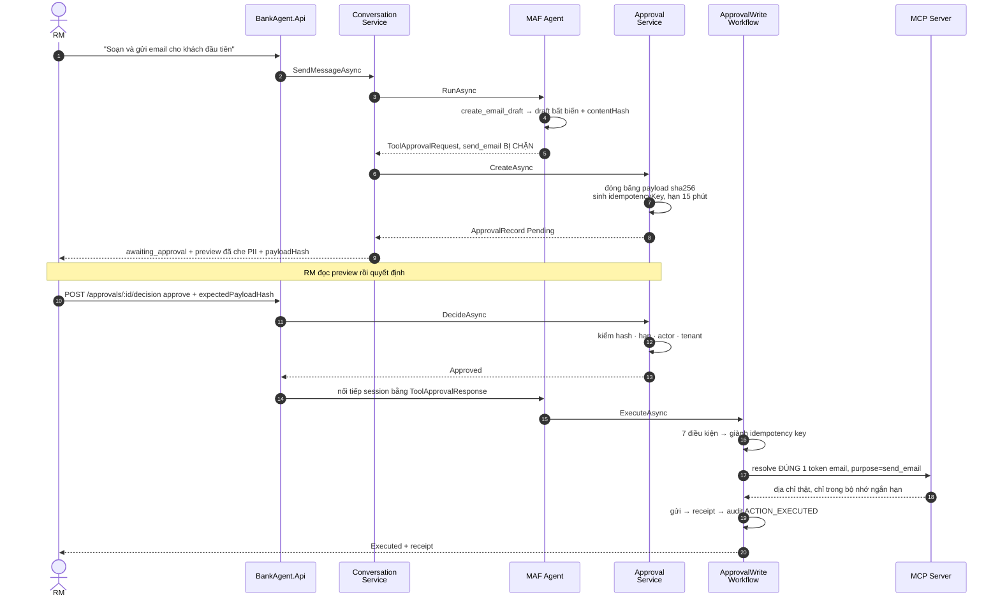

# Bank CRM Agent (RM Assistant)

Agent host cho Relationship Manager, xây theo [`docs/spec.md`](docs/spec.md) (`SPEC-BANK-CRM-AGENT-001`) trên Microsoft Agent Framework 1.17 (.NET 10).

MCP Server **không** nằm trong repo này — nó là dự án riêng [`bankassist-mcp`](../bankassist-mcp). Repo này là mọi thứ ở phía trên nó: agent, policy, approval workflow, RAG, audit, API.

---

## 1. Ý tưởng trung tâm

Spec tách rõ hai loại quyết định, và toàn bộ mã nguồn tổ chức quanh ranh giới đó:

| Phần XÁC SUẤT — model quyết định | Phần XÁC ĐỊNH — code quyết định |
|---|---|
| Gọi tool đọc nào | Ai được xem khách hàng nào |
| Tổng hợp câu trả lời | Tool nào tồn tại |
| Soạn nội dung nháp | Hành động ghi có được chạy không |
| Đề xuất hành động tiếp theo | Payload nào thực sự được gửi |
| | Retry có tạo tác động thứ hai không |

Model không bao giờ tự thực hiện được một hành động có tác động nghiệp vụ. Ba lớp chặn độc lập:



| Lớp | Cơ chế | File |
|---|---|---|
| 1 | `ApprovalRequiredAIFunction` + `UseToolApproval` | [WriteTools.cs](src/BankAgent.Agent/Tools/WriteTools.cs) |
| 2 | `AgentExecutionScope.ResumingApprovalId` + so lại hash | [WriteTools.cs:107](src/BankAgent.Agent/Tools/WriteTools.cs#L107) |
| 3 | trạng thái · hạn · actor · hash · allowlist · quyền · idempotency | [ApprovalWriteWorkflow.cs](src/BankAgent.Workflows/ApprovalWriteWorkflow.cs) |

---

## 2. Kiến trúc



`Application` chỉ biết hai cổng — `IAgentRunner` và `IWriteActionExecutor` — nên phần approval, policy và audit test được mà không cần model thật.

**Đường màu cam không bao giờ chạm dữ liệu thô.** Model chỉ nhìn thấy token `[PERSON_1]`, `[EMAIL_1]`; đường tới `/vault/resolve` xuất phát từ Workflows chứ không từ Agent, và không được đăng ký làm MCP tool.

### Luồng đọc — UC-01



### Luồng ghi — UC-06



---

## 3. Hướng dẫn chạy

### 3.1 Yêu cầu

| Thành phần | Kiểm tra | Ghi chú |
|---|---|---|
| .NET 10 SDK | `dotnet --version` → `10.x` | bắt buộc |
| `bankassist-mcp` | thư mục cạnh repo này | cần cho tool đọc CRM |
| Azure OpenAI | endpoint + deployment | cần cho vòng ReAct; thiếu thì chỉ chạy được health/auth |

### 3.2 Build và test trước

```bash
cd rm-assistant
dotnet build BankCrmAgent.slnx     # kỳ vọng: Build succeeded, 0 warning
dotnet test                        # kỳ vọng: Passed! 57 test
```

Bước này không cần MCP Server lẫn model — nếu nó hỏng thì vấn đề nằm ở máy, không phải ở cấu hình.

### 3.3 Bước 1 — chạy MCP Server

```bash
cd ../bankassist-mcp
dotnet run --project src/BankAssist.Mcp        # http://localhost:5026
```

Server **từ chối khởi động** nếu thiếu khoá. Đặt vào `src/BankAssist.Mcp/appsettings.Development.json` (đã nằm trong `.gitignore` của repo đó):

```json
{
  "BANKASSIST_AES_KEY": "<32 byte ngẫu nhiên, Base64>",
  "BANKASSIST_API_KEY": "<chuỗi tối thiểu 16 ký tự>"
}
```

Sinh khoá nhanh:

```bash
openssl rand -base64 32     # AES key
openssl rand -hex 24        # API key
```

Xác nhận:

```bash
curl -s http://localhost:5026/health
# {"status":"ok"}
```

### 3.4 Bước 2 — cấu hình agent host

Tạo `src/BankAgent.Api/appsettings.Development.json` (file này **gitignored** — đừng commit):

```json
{
  "Model": {
    "Provider": "AzureOpenAI",
    "Endpoint": "https://<resource>.openai.azure.com/",
    "DeploymentName": "gpt-4o"
  },

  "PiiResolve": {
    "ApiKey": "<BANKASSIST_API_KEY giống bước 1>"
  },

  "Auth": {
    "AllowDevHeaders": true,
    "RmPortfolios": {
      "RM007": ["PF-HN01"],
      "RM002": ["PF-HCM01"]
    }
  },

  "Authorization": {
    "AllowUnmappedCustomers": false,
    "CustomerPortfolioMap": {
      "CUS0001": "PF-HN01",
      "CUS0002": "PF-HN01",
      "CUS0003": "PF-HCM01"
    }
  }
}
```

`AllowDevHeaders` bật thì danh tính lấy từ header `X-Dev-*`. Bật cờ này ngoài `Development` thì app **từ chối khởi động** ([Program.cs:32](src/BankAgent.Api/Program.cs#L32)) — nếu danh tính giả mạo được bằng header thì mọi kiểm soát phía sau đều vô nghĩa.

Production: bỏ `AllowDevHeaders`, đặt `Auth:Authority` + `Auth:Audience` để bật JWT Bearer; danh tính lấy từ claim `oid`/`tid`. Bỏ trống `Model:ApiKey` để dùng Managed Identity.

### 3.5 Bước 3 — chạy agent host

```bash
cd rm-assistant
dotnet run --project src/BankAgent.Api        # http://localhost:5080
```

Xác nhận hai điều:

```bash
curl -s http://localhost:5080/health
# {"status":"ok"}

curl -s http://localhost:5080/health/ready
# {"status":"ok","knowledgeChunks":6}
```

`knowledgeChunks: 6` nghĩa là knowledge base đã nạp và **checksum khớp**. Số 0 nghĩa là file bị sửa tay ngoài ingestion — xem mục 3.8.

Trong log khởi động, tìm dòng xác nhận MCP đã kết nối:

```
info: BankAgent.Agent.Mcp.McpToolProvider[0]
      Bỏ qua tool MCP 'ping': Tool 'ping' không nằm trong allowlist.
info: BankAgent.Agent.Mcp.McpToolProvider[0]
      Đã nạp 2/3 tool MCP cho phiên.
```

Dòng thứ nhất là allowlist phía host đang làm việc: MCP Server publish gì cũng được, chỉ tool nằm trong policy mới đến được model.

### 3.6 Bước 4 — gọi thử luồng đọc

```bash
curl -s -X POST http://localhost:5080/api/conversations/conv-001/messages \
  -H 'Content-Type: application/json' \
  -H 'X-Dev-Rm-Id: RM007' \
  -H 'X-Dev-Tenant-Id: tenant-a' \
  -d '{"message":"Khách nào đáo hạn trong 30 ngày tới?"}' | jq
```

Phản hồi:

```json
{
  "conversationId": "conv-001",
  "messageId": "msg_...",
  "status": "completed",
  "answer": "[dữ kiện] Có 3 khách hàng ... [gợi ý] ...",
  "sources": [{ "label": "CRM/Deposits", "dataAsOf": "2026-08-16T08:30:00Z" }],
  "approval": null,
  "traceId": "..."
}
```

Bỏ hai header `X-Dev-*` → `401`. Đó là kiểm chứng nhanh nhất rằng danh tính không đến từ body.

### 3.7 Bước 5 — thử luồng phê duyệt

```bash
# 1. Yêu cầu một hành động ghi
curl -s -X POST http://localhost:5080/api/conversations/conv-001/messages \
  -H 'Content-Type: application/json' \
  -H 'X-Dev-Rm-Id: RM007' -H 'X-Dev-Tenant-Id: tenant-a' \
  -d '{"message":"Soạn email nhắc đáo hạn cho CUS0001 rồi gửi giúp tôi"}' | jq
```

Kỳ vọng `status: "awaiting_approval"` kèm khối `approval`:

```json
{
  "status": "awaiting_approval",
  "approval": {
    "approvalId": "apr_...",
    "action": "send_email",
    "maskedTarget": "CUS0001",
    "preview": "Tiêu đề: ...\n\n...",
    "expectedChanges": ["Gửi một email tới khách hàng", "..."],
    "risks": ["Email đã gửi không thu hồi được", "..."],
    "payloadHash": "sha256:...",
    "expiresAt": "2026-08-16T08:45:00Z"
  }
}
```

```bash
# 2. Duyệt — phải gửi lại đúng payloadHash đã xem
curl -s -X POST http://localhost:5080/api/approvals/<approvalId>/decision \
  -H 'Content-Type: application/json' \
  -H 'X-Dev-Rm-Id: RM007' -H 'X-Dev-Tenant-Id: tenant-a' \
  -d '{"decision":"approve","comment":"Đã kiểm tra","expectedPayloadHash":"sha256:..."}' | jq
```

Vài ca đáng thử tay:

| Gửi gì | Kỳ vọng |
|---|---|
| `expectedPayloadHash` sai một ký tự | `409` · `PAYLOAD_CHANGED` |
| Duyệt sau 15 phút | `409` · `APPROVAL_EXPIRED` |
| Đổi `X-Dev-Rm-Id` sang RM khác | `404` — không xác nhận approval có tồn tại |
| Duyệt lại lần hai | `409` · `IDEMPOTENCY_CONFLICT` |
| `decision: "reject"` | `200`, trạng thái `Rejected`, không thực thi |

### 3.8 Kiểm tra audit

```bash
tail -f src/BankAgent.Api/bin/Debug/net10.0/audit/audit-$(date +%Y%m%d).jsonl
```

```json
{"eventId":"evt_...","eventType":"TOOL_CALL_COMPLETED","occurredAt":"2026-08-16T08:30:00Z",
 "traceId":"...","conversationId":"conv-001","tenantId":"tenant-a","actorId":"RM007",
 "agentVersion":"bank-agent/1.0.0","toolName":"search_customers",
 "inputDigest":"sha256:...","outputDigest":"sha256:...","policyDecision":"allow",
 "outcome":"success","durationMs":421,"pii":"tokenized"}
```

Chỉ có **digest**, không có nội dung. Cách kiểm tra thẳng thắn nhất — lấy một tên có thật trong `../bankassist-mcp/data/customers.json` rồi tìm nó trong audit:

```bash
grep -c "Nguyễn" src/BankAgent.Api/bin/Debug/net10.0/audit/*.jsonl   # kỳ vọng: 0
```

Nối một request từ đầu đến cuối:

```bash
jq -r 'select(.traceId=="<traceId>") | "\(.occurredAt) \(.eventType) \(.outcome)"' \
  src/BankAgent.Api/bin/Debug/net10.0/audit/*.jsonl
```

### 3.9 Khi có gì đó không chạy

| Triệu chứng | Nguyên nhân | Xử lý |
|---|---|---|
| Log: `Không kết nối được MCP Server; chạy tiếp với tool cục bộ` | MCP Server chưa chạy | Quay lại bước 3.3. Agent vẫn chạy nhưng không có dữ liệu CRM — đúng thiết kế, nó phải nói rõ thay vì bịa |
| Request treo rồi timeout | `Model:Endpoint` còn là placeholder; `ManagedIdentityCredential` đang thử IMDS | Điền endpoint thật, hoặc đặt tạm `Model:ApiKey` cho dev |
| `401` ở mọi request | Thiếu header `X-Dev-*`, hoặc `AllowDevHeaders` chưa bật | Xem bước 3.4 |
| App từ chối khởi động, log nhắc `FR-001` | `AllowDevHeaders: true` ngoài `Development` | Cố ý. Tắt cờ hoặc đặt `ASPNETCORE_ENVIRONMENT=Development` |
| `knowledgeChunks: 0` | Checksum lệch hoặc thiếu thư mục `knowledge/` | Log nêu rõ chunk nào lệch. Sửa nội dung thì phải tính lại `checksum` |
| `send_email` trả `PII_TOKEN_INVALID` | `bankassist-mcp` chưa có `/vault/resolve` (task T-16 bên đó) | Xem mục 5 |
| `FORBIDDEN_PORTFOLIO` với khách hợp lệ | Khách chưa có trong `Authorization:CustomerPortfolioMap` | Fail closed có chủ đích. Thêm ánh xạ ở bước 3.4 |

---

## 4. Trạng thái theo Phase của spec

| Phase | Nội dung | Trạng thái |
|---|---|---|
| 0 | Solution, central package management, config, health, audit correlation | ✅ |
| 1 | MCP read path | ✅ dùng `bankassist-mcp` sẵn có |
| 2 | Agent/ReAct, session store, middleware, chat API | ✅ |
| 3 | RAG + citation + insufficient evidence + injection test | ✅ |
| 4 | PII guard phía host + host-only resolve client | ✅ |
| 5 | Draft, payload hash, approval, idempotent write | ✅ |
| 6 | Eval 20+ golden case, load/chaos test | ⬜ chưa làm |

### Đã kiểm chứng bằng chạy thật

- Build sạch, **57/57 unit test pass**.
- API khởi động, nạp 6 chunk tri thức, checksum khớp.
- Kết nối MCP Server thật: liệt kê 3 tool, allowlist loại `ping`, nạp 2/3.
- Request không có danh tính → `401`.
- Audit ghi `CONVERSATION_STARTED` → `AGENT_RUN_STARTED` với `pii: tokenized`.

---

## 5. Chưa kiểm chứng

Không có Azure OpenAI endpoint thật trong môi trường phát triển hiện tại, nên **mọi thứ từ lời gọi model trở đi chưa chạy end-to-end**. Cụ thể:

- Vòng ReAct và việc model chọn đúng tool.
- Việc framework phát `ToolApprovalRequestContent` rồi nối lại bằng `ToolApprovalResponseContent`
  ([MafAgentRunner.cs:238](src/BankAgent.Agent/MafAgentRunner.cs#L238)) — **đây là mắt xích rủi ro nhất**, cần test tích hợp với model thật trước khi tin.
- Serialize/deserialize `AgentSession` qua nhiều lượt.

Toàn bộ phần **sau** khi có approval — hash, hạn, quyền, idempotency, resolve PII, receipt — đã test kỹ vì nó không phụ thuộc model.

`bankassist-mcp` cũng chưa có `/vault/resolve`, nên `send_email` sẽ dừng ở `PII_TOKEN_INVALID` cho tới khi endpoint đó tồn tại.

---

## 6. Test

```bash
dotnet test                                            # 57 test
dotnet test --filter FullyQualifiedName~ApprovalGate    # cổng phê duyệt
dotnet test --filter FullyQualifiedName~WriteWorkflow   # idempotency, hash, hạn
dotnet test --filter FullyQualifiedName~Security        # PII, portfolio, session
dotnet test --filter FullyQualifiedName~Rag             # citation, abstain, injection
dotnet test --filter FullyQualifiedName~ToolPolicy      # allowlist, vai trò
```

Ánh xạ sang golden case của spec §21.2:

| Golden case | Test |
|---|---|
| 2, 4 — RM khác không thấy dữ liệu ngoài quyền, không lộ existence | `SecurityBoundaryTests` |
| 5, 6, 7 — citation còn hiệu lực, loại chính sách hết hạn, abstain | `RagTests` |
| 8 — prompt injection trong tài liệu bị coi là dữ liệu | `RagTests` |
| 10 — send không approval → fail | `WriteWorkflowTests` |
| 11 — approval bị sửa payload → fail | `ApprovalGateTests`, `WriteWorkflowTests` |
| 12 — approval hết hạn → fail | cả hai |
| 13 — retry cùng idempotency key → một tác động | `WriteWorkflowTests` |
| 14 — token khác tenant → fail + audit | `ApprovalGateTests` |
| 15, 16 — PII thô không lọt ra model/log | `SecurityBoundaryTests` |
| 19 — vòng tool vượt 3 → dừng an toàn | `ToolPolicyTests` + [ToolInvocationMiddleware.cs:56](src/BankAgent.Agent/Middleware/ToolInvocationMiddleware.cs#L56) |

Còn thiếu để đủ 20 case: 1, 3, 9, 17, 18, 20 — cần model thật hoặc test tích hợp (Phase 6).

---

## 7. Những chỗ cần thay trước production

| Hạng mục | Hiện tại | Cần |
|---|---|---|
| Store (session, approval, draft, idempotency) | in-memory | Redis/SQL — nhiều instance là mất trạng thái |
| Audit | file JSONL append-only | WORM store (SEC-008) |
| `Authorization:CustomerPortfolioMap` | config tĩnh | truy vấn hệ thống phân quyền |
| RAG | lexical scoring | hybrid keyword + vector (§10.3) |
| Kênh gửi email/CRM | `LoggingEmailChannel` mô phỏng | tích hợp thật |
| `Rag:ScoreThreshold` | 0.15 tạm đặt | hiệu chỉnh bằng eval — spec đánh dấu `[DECISION REQUIRED]` |

Các `[D-01]`…`[D-08]` ở spec §25 vẫn mở.

---

## 8. Ba điều tuyệt đối không làm

1. **Không đăng ký `/vault/resolve` thành MCP tool.** LLM gọi được nó là toàn bộ mô hình PII sụp đổ (FR-032).
2. **Không cho write tool tự chạy.** Bỏ `ApprovalRequiredAIFunction` hoặc thêm auto-approval rule là bỏ luôn FR-021.
3. **Không log giá trị đã hoàn nguyên.** `ResolvedPii` là `IDisposable` có chủ đích — dùng trong bộ nhớ ngắn hạn rồi xoá tham chiếu (§8.3).
