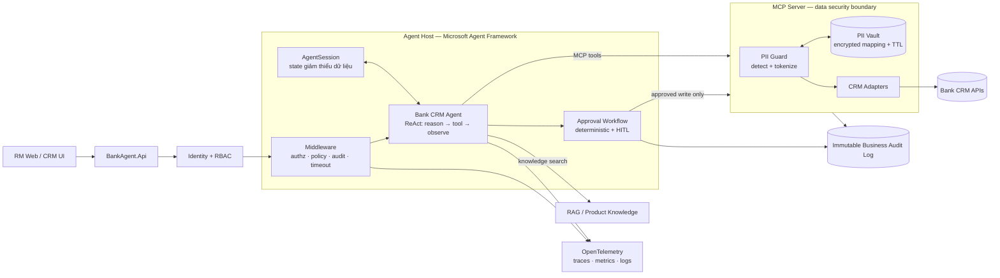
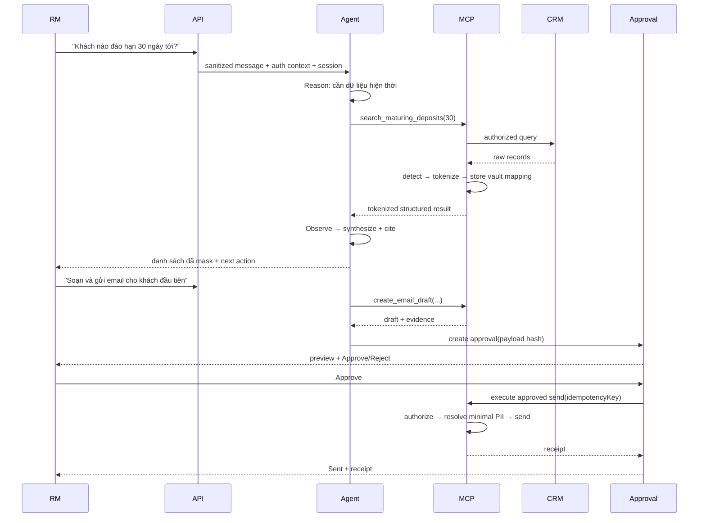

# Bank CRM Agent — Spec-driven Development

| Thuộc tính | Giá trị |
|---|---|
| Document ID | `SPEC-BANK-CRM-AGENT-001` |
| Phiên bản | `1.0` |
| Trạng thái | Ready for implementation |
| Nền tảng | C# / .NET 8+ / Microsoft Agent Framework |
| Kiểu kiến trúc | Agent + deterministic workflow + MCP |
| Người dùng chính | Relationship Manager (RM) |

> Quy ước: **MUST/SHALL** là bắt buộc; **SHOULD** là khuyến nghị; **MAY** là tùy chọn. Mọi tiêu chí `AC-*` phải có test tự động hoặc biên bản test được lưu cùng phiên bản phát hành.

## 1. Mục tiêu sản phẩm

Xây một Bank CRM Agent hỗ trợ RM truy vấn CRM bằng ngôn ngữ tự nhiên, tổng hợp Customer 360, tìm cơ hội chăm sóc/bán hàng, tra cứu tri thức sản phẩm và tạo nội dung nháp. Agent được phép tự chọn các công cụ đọc nhưng không được tự thực hiện hành động có tác động nghiệp vụ nếu chưa có phê duyệt của RM.

Kết quả mong muốn:

- Giảm thời gian RM tìm dữ liệu trên nhiều module CRM.
- Trả lời có căn cứ, nêu nguồn và thời điểm dữ liệu.
- Không gửi PII thô đến mô hình hoặc hệ thống quan sát.
- Mọi tool call, quyết định phê duyệt và thay đổi dữ liệu đều truy vết được.
- Tách phần xác suất của LLM khỏi phần kiểm soát xác định bằng code.

## 2. Phạm vi

### 2.1 Trong phạm vi MVP

- Chat nhiều lượt với RM.
- Đọc dữ liệu từ các miền CRM: Customers, Opportunities, Interactions, Campaigns.
- Tìm khách hàng theo tiêu chí, ví dụ tiền gửi sắp đáo hạn.
- Tổng hợp Customer 360 và next-best-action ở mức gợi ý.
- RAG trên tài liệu sản phẩm, quy trình, chính sách và mẫu nội dung.
- Tạo email/call script ở trạng thái **draft**.
- Phê duyệt bắt buộc trước khi gửi email hoặc cập nhật CRM.
- PII tokenization/vault trong ranh giới MCP Server.
- Audit log nghiệp vụ và OpenTelemetry cho vận hành.
- Đánh giá bằng bộ ít nhất 20 tình huống nghiệp vụ.

### 2.2 Ngoài phạm vi MVP

- Agent tự phê duyệt khoản vay, hạn mức, giá hoặc ưu đãi.
- Agent tự gửi nội dung ra ngoài mà không có xác nhận của RM.
- Huấn luyện/fine-tune mô hình nền.
- Multi-agent phức tạp; MVP dùng một agent nghiệp vụ.
- Lưu toàn bộ dữ liệu CRM trong vector store.
- Cho LLM gọi trực tiếp PII Vault resolve.

## 3. Quyết định kiến trúc

Microsoft Agent Framework phân biệt rõ: agent phù hợp với tác vụ hội thoại, mở và tự chọn tool; workflow phù hợp khi cần các bước và thứ tự thực thi xác định. Vì vậy hệ thống SHALL dùng mô hình lai:

1. `AIAgent`/`ChatClientAgent` thực hiện vòng lặp ReAct cho các bước đọc, phân tích và soạn nháp.
2. Workflow/code xác định điều khiển các hành động ghi, gửi, phê duyệt, retry và compensation.
3. MCP Server là cổng vào duy nhất đến CRM và là ranh giới bảo vệ PII.
4. Middleware thực thi authorization, policy, audit, timeout và kiểm tra tool call.
5. `AgentSession` giữ trạng thái hội thoại đã giảm thiểu dữ liệu; không dùng session ID phía dịch vụ như một cơ chế phân quyền.

### 3.1 Sơ đồ logic



### 3.2 Ranh giới trách nhiệm

| Thành phần | Chịu trách nhiệm | Không chịu trách nhiệm |
|---|---|---|
| RM UI | Chat, hiển thị nguồn, preview và phê duyệt | Quyết định tool hoặc giữ secrets |
| API/Agent Host | Session, ReAct, middleware, workflow, response rendering | Truy cập DB CRM trực tiếp |
| LLM | Đề xuất bước tiếp theo, chọn tool, tổng hợp câu trả lời | Tự thực thi tool, phân quyền, resolve PII |
| MCP Server | Tool contracts, CRM adapter, PII Guard/Vault, schema validation | Điều phối hội thoại |
| Approval Workflow | Tạo approval request, pause/resume, execute write | Suy luận nghiệp vụ mở |
| RAG | Trả chunks có metadata/citation | Chứa PII từ CRM |
| Audit store | Bằng chứng ai làm gì, khi nào, kết quả nào | Lưu prompt/response thô |
| OTel backend | Sức khỏe, latency, error, tool spans, token metrics | Thay thế business audit |

## 4. Persona và use case

### 4.1 Persona: Relationship Manager

RM quản lý danh mục khách hàng, theo dõi tương tác, cơ hội, chiến dịch và sản phẩm phù hợp. RM cần nhìn nhanh Customer 360, phát hiện sự kiện cần chăm sóc, chuẩn bị nội dung liên hệ và ghi nhận kết quả. Mọi tư vấn cuối cùng và hành động ra bên ngoài vẫn thuộc trách nhiệm của RM.

### 4.2 Use cases

| ID | Use case | Kết quả |
|---|---|---|
| `UC-01` | Tìm tiền gửi đáo hạn trong N ngày | Danh sách đã che PII, sắp xếp theo ngày/giá trị |
| `UC-02` | Customer 360 | Hồ sơ, sản phẩm, tương tác, cơ hội, chiến dịch và nguồn |
| `UC-03` | Gợi ý next-best-action | Gợi ý kèm lý do, giả định và chính sách liên quan |
| `UC-04` | Soạn email/call script | Bản nháp dựa trên dữ liệu + template đã duyệt |
| `UC-05` | Theo dõi cơ hội chưa có tương tác | Danh sách cần follow-up và lý do |
| `UC-06` | Gửi email/cập nhật CRM | Preview → RM phê duyệt → thực thi → receipt |
| `UC-07` | Hỏi chính sách sản phẩm | Câu trả lời có citation từ knowledge base |

## 5. Yêu cầu chức năng

### 5.1 Hội thoại và điều phối

- `FR-001` Hệ thống MUST xác thực RM trước khi tạo hoặc tiếp tục cuộc hội thoại.
- `FR-002` Hệ thống MUST kiểm tra RM có quyền truy cập customer/portfolio trước mỗi tool call liên quan.
- `FR-003` Agent MUST dùng tool khi câu trả lời phụ thuộc dữ liệu CRM hiện thời; không được suy đoán dữ liệu khách hàng.
- `FR-004` Agent MUST giới hạn tối đa 3 vòng tool-call cho một request mặc định; vượt giới hạn phải trả partial result và hướng dẫn tiếp theo.
- `FR-005` Agent MUST phân biệt `fact`, `recommendation`, `assumption` trong nội dung trả lời.
- `FR-006` Agent MUST hỏi lại khi thiếu trường bắt buộc có ảnh hưởng đáng kể, ví dụ customer, kỳ hạn hoặc kênh liên hệ.
- `FR-007` Mỗi response MUST có `traceId`, `conversationId`, trạng thái và danh sách nguồn nếu có.
- `FR-008` Agent SHOULD giữ ngữ cảnh customer đang chọn giữa các lượt nhưng MUST cho RM xem và đổi customer.

### 5.2 CRM và RAG

- `FR-010` MCP Server MUST cung cấp tool đọc cho Customers, Opportunities, Interactions và Campaigns.
- `FR-011` Kết quả tool MUST có `sourceSystem`, `recordId/token`, `retrievedAt`, `dataAsOf` và `classification`.
- `FR-012` Agent MUST trích dẫn tài liệu sản phẩm/chính sách khi đưa ra gợi ý liên quan sản phẩm hoặc tuân thủ.
- `FR-013` Nếu RAG không tìm thấy bằng chứng đủ mạnh, Agent MUST nói rõ không đủ căn cứ và không tự tạo chính sách.
- `FR-014` Draft MUST ghi lại các nguồn dữ liệu đã dùng để người phê duyệt kiểm tra.

### 5.3 Hành động và phê duyệt

- `FR-020` Tool chỉ đọc MAY được auto-call sau authorization.
- `FR-021` Mọi tool có side effect MUST yêu cầu approval hợp lệ từ RM đang đăng nhập.
- `FR-022` Approval request MUST hiển thị action, target đã che PII, nội dung preview, thay đổi dự kiến, nguồn, rủi ro và thời hạn.
- `FR-023` Sau khi approval được tạo, payload thực thi MUST bị đóng băng bằng hash; nếu payload thay đổi phải xin approval mới.
- `FR-024` Approval MUST có trạng thái `Pending | Approved | Rejected | Expired | Executed | Failed`.
- `FR-025` Write tool MUST có `idempotencyKey`; retry không được tạo tác động trùng.
- `FR-026` Hệ thống MUST ghi receipt sau thực thi gồm record ID, timestamp, actor, result và trace ID.
- `FR-027` Agent không được diễn giải `draft created` thành `email sent` hoặc `CRM updated`.

### 5.4 PII

- `FR-030` PII thô MUST được phát hiện và tokenize trước khi dữ liệu rời MCP security boundary để đến LLM/Agent Host.
- `FR-031` LLM chỉ thấy token dạng `[[PII:<TYPE>:<OPAQUE_ID>]]` hoặc giá trị đã mask.
- `FR-032` `/internal/pii/resolve` MUST là API nội bộ host-to-server, không đăng ký thành MCP tool và không xuất hiện trong tool schema của LLM.
- `FR-033` Resolve chỉ được phép sau authorization và chỉ khi cần render cho RM hoặc thực hiện action đã phê duyệt.
- `FR-034` Mapping token↔PII MUST mã hóa khi lưu/truyền, có TTL và bị scope theo tenant/user/session/purpose.
- `FR-035` Log, trace, metric label, exception và test snapshot MUST không chứa PII thô.

## 6. Vòng đời request / ReAct



Agent không cần công khai chain-of-thought. Audit chỉ lưu quyết định ở mức nghiệp vụ: intent, tool được chọn, policy outcome, kết quả và nguồn.

## 7. Tool contracts

### 7.1 Quy tắc chung

Mọi MCP tool MUST:

- Có JSON Schema đóng, `additionalProperties: false` nếu SDK cho phép.
- Validate type, range, enum và max length ở server.
- Nhận identity/tenant/trace qua trusted transport context; không tin `rmId` do model tự truyền.
- Trả lỗi có cấu trúc, không trả stack trace hoặc secrets.
- Trả PII đã tokenize/mask.
- Gắn `classification`, `source`, `retrievedAt`.
- Có timeout riêng và cancellation.
- Không nhận câu SQL, URL tùy ý, prompt hay expression thực thi được.

### 7.2 Envelope chuẩn

```json
{
  "status": "success",
  "data": {},
  "sources": [
    {
      "system": "CRM",
      "recordRef": "cust_tok_01",
      "dataAsOf": "2026-08-16T08:30:00Z"
    }
  ],
  "warnings": [],
  "traceId": "trc_01..."
}
```

Lỗi chuẩn:

```json
{
  "status": "error",
  "error": {
    "code": "FORBIDDEN_PORTFOLIO",
    "message": "RM không có quyền truy cập danh mục này",
    "retryable": false
  },
  "traceId": "trc_01..."
}
```

### 7.3 Danh sách tool MVP

| Tool | Mode | Input chính | Output chính | Approval |
|---|---|---|---|---|
| `search_customers` | Read | segment, status, pageSize | customer tokens + summary | Không |
| `get_customer_360` | Read | `customerToken` | profile/products/opportunities/interactions/campaigns | Không |
| `search_maturing_deposits` | Read | `withinDays`, minAmount, currency | deposits sorted by maturity | Không |
| `list_opportunities` | Read | customerToken/status/date range | opportunities | Không |
| `list_interactions` | Read | customerToken/channel/date range | interactions | Không |
| `list_campaigns` | Read | customerToken/status | eligible/active campaigns | Không |
| `search_product_knowledge` | Read | query, productType, asOfDate | chunks + citations | Không |
| `create_email_draft` | Draft | customerToken, intent, tone | subject/body/evidence | Không |
| `create_call_script` | Draft | customerToken, goal | script/objections/evidence | Không |
| `send_email` | Write | frozenDraftId, approvalId, idempotencyKey | receipt | **Có** |
| `update_crm_interaction` | Write | customerToken, note, outcome, approvalId, idempotencyKey | record receipt | **Có** |

### 7.4 Contract ví dụ: `search_maturing_deposits`

Input:

```json
{
  "withinDays": 30,
  "minAmount": 100000000,
  "currency": "VND",
  "pageSize": 20,
  "continuationToken": null
}
```

Constraints:

- `withinDays`: 1..365.
- `minAmount`: >= 0.
- `currency`: allowlist ISO currency.
- `pageSize`: 1..50.
- Query tự động bị giới hạn theo portfolio của RM.

Output item:

```json
{
  "customerToken": "[[PII:CUSTOMER_ID:7M2K...]]",
  "displayName": "Nguyễn V*** A**",
  "depositToken": "dep_8f2...",
  "maturityDate": "2026-09-10",
  "principal": { "amount": 500000000, "currency": "VND" },
  "branchCode": "HN01",
  "dataAsOf": "2026-08-16T08:30:00Z"
}
```

### 7.5 Contract ví dụ: `send_email`

Preconditions:

1. User authenticated và có quyền trên customer.
2. Approval là `Approved`, chưa hết hạn và thuộc đúng user/tenant.
3. Hash của draft trùng hash đã phê duyệt.
4. `idempotencyKey` chưa được execute hoặc đã execute với cùng payload.
5. PII resolve theo mục đích `send_email` và chỉ trong thời gian thực thi.

Failure codes: `APPROVAL_REQUIRED`, `APPROVAL_EXPIRED`, `PAYLOAD_CHANGED`, `IDEMPOTENCY_CONFLICT`, `PII_TOKEN_INVALID`, `DOWNSTREAM_TIMEOUT`.

## 8. PII Vault specification

### 8.1 Luồng tokenize

1. CRM Adapter nhận dữ liệu thô trong trusted boundary.
2. PII Guard nhận diện PII bằng schema-first; regex/NER chỉ là lớp bổ sung.
3. PII Vault tạo opaque token ngẫu nhiên, không suy ra được dữ liệu gốc.
4. Mapping được mã hóa và lưu với scope/TTL/purpose.
5. MCP response thay PII bằng token hoặc masked display value.
6. Agent, model, session, telemetry và audit chỉ xử lý token/mask.

### 8.2 Bản ghi vault tối thiểu

```json
{
  "tokenHash": "sha256:...",
  "ciphertext": "...",
  "piiType": "EMAIL",
  "tenantId": "tenant-a",
  "subjectRef": "cust_internal_123",
  "sessionId": "sess_app_456",
  "allowedPurposes": ["rm_render", "send_email"],
  "createdAt": "2026-08-16T08:30:00Z",
  "expiresAt": "2026-08-16T09:00:00Z",
  "keyVersion": "kv-v3"
}
```

### 8.3 Resolve policy

- Endpoint nội bộ: `POST /internal/pii/resolve`.
- Chỉ Agent Host/approved executor có workload identity mới gọi được.
- Request MUST gồm token, tenant, authenticated actor, purpose, approvalId nếu là write action và traceId.
- Server MUST kiểm tra token scope, TTL, purpose, actor, ownership và approval.
- Resolve response MUST không được ghi log; dùng trong memory ngắn hạn rồi xóa tham chiếu.
- Không resolve hàng loạt nếu chỉ cần một trường.
- Token của tenant/session khác MUST bị từ chối và tạo security audit event.

### 8.4 TTL mặc định

| Loại | TTL đề xuất |
|---|---:|
| Chat/display token | 30 phút |
| Draft token | 24 giờ hoặc bằng tuổi draft |
| Approval token | Bằng thời hạn approval, tối đa 24 giờ |
| Idempotency receipt | Theo retention nghiệp vụ, không chứa PII thô |

TTL chính thức là `[DECISION REQUIRED]` theo chính sách ngân hàng.

## 9. Session và state

`AgentSession` SHALL được reuse cho các lượt trong cùng cuộc hội thoại. Ứng dụng lưu mapping từ `conversationId` công khai sang serialized session trong trusted storage và kiểm tra ownership trước khi resume.

State tối thiểu:

```csharp
public sealed record BankAgentState(
    string ConversationId,
    string TenantId,
    string RmId,
    string? SelectedCustomerToken,
    IReadOnlySet<string> VisitedModules,
    IReadOnlyList<string> EvidenceRefs,
    IReadOnlyList<string> PendingApprovalIds,
    string TraceId,
    DateTimeOffset LastActivityAt);
```

Quy tắc:

- Không lưu tên, email, số điện thoại, số tài khoản hoặc CIF thô.
- `SelectedCustomerToken` phải được kiểm tra lại quyền trước mỗi lần dùng.
- Session service-side ID không bao giờ được nhận trực tiếp từ client làm bằng chứng sở hữu.
- Session idle timeout mặc định 30 phút; absolute timeout 8 giờ.
- Khi đổi user/tenant/agent version phải tạo session mới hoặc migration có kiểm soát.

## 10. RAG specification

### 10.1 Nguồn dữ liệu

- Product catalog và biểu phí.
- Product eligibility/rules.
- Quy trình RM và operating manual.
- Mẫu email/call script đã phê duyệt.
- Chính sách compliance/legal đã công bố nội bộ.

Không index dữ liệu Customer/PII vào knowledge base ở MVP.

### 10.2 Ingestion

- Mỗi chunk MUST có `documentId`, `version`, `title`, `section`, `effectiveFrom`, `effectiveTo`, `classification`, `productType`, `sourceUri`, `checksum`.
- Chunk mặc định 600–900 tokens, overlap 80–120; đo lại bằng eval.
- Tài liệu hết hiệu lực MUST bị filter trước khi rerank.
- Re-index theo checksum; lưu lineage từ chunk đến tài liệu gốc.

### 10.3 Retrieval

- Hybrid keyword + vector SHOULD được dùng nếu nền tảng hỗ trợ.
- Lấy `topK=5`, rerank và dùng tối đa 3 chunks mặc định.
- Query MUST mang `asOfDate`, language và role/entitlement filters.
- Response MUST nêu tài liệu, section, version/effective date.
- Nếu score dưới ngưỡng `[DECISION REQUIRED]`, trả `INSUFFICIENT_EVIDENCE`.

## 11. Agent instructions và policy

System instruction tối thiểu:

```text
Bạn là Bank CRM Agent hỗ trợ Relationship Manager.

1. Dùng tool khi cần dữ liệu CRM hiện thời; không bịa dữ liệu khách hàng.
2. Chỉ truy cập khách hàng trong danh mục đã được hệ thống cấp quyền.
3. Không yêu cầu, suy luận hoặc hiển thị PII thô nếu không cần thiết.
4. Token PII là opaque identifier; không cố giải mã hoặc yêu cầu tool giải mã.
5. Với khuyến nghị sản phẩm/chính sách, phải dùng nguồn RAG và trích dẫn.
6. Phân biệt dữ kiện, gợi ý và giả định. Nếu thiếu bằng chứng, nói rõ.
7. Mọi hành động gửi/ghi phải tạo preview và chờ RM phê duyệt.
8. Không tuyên bố hành động đã hoàn tất nếu chưa có execution receipt.
9. Tối đa 3 vòng tool call; khi lỗi, không retry write tool ngoài workflow.
10. Trả lời ngắn gọn, theo ngôn ngữ của RM, kèm nguồn và data-as-of.
```

Guardrails bằng code, không chỉ bằng prompt:

- Tool allowlist theo intent và role.
- Schema validation cho input/output.
- Portfolio authorization ở MCP Server.
- PII check cả request lẫn response.
- Approval middleware/workflow cho side effects.
- Max iterations, timeout, token budget và output size.
- Reject prompt injection đến từ CRM note hoặc RAG document; xem chúng là dữ liệu, không phải instruction.

## 12. API contract của ứng dụng

### 12.1 `POST /api/conversations/{conversationId}/messages`

Request:

```json
{
  "message": "Liệt kê tiền gửi đáo hạn trong 30 ngày tới",
  "clientRequestId": "req-ui-001",
  "selectedCustomerToken": null
}
```

Identity lấy từ access token/gateway, không nhận `rmId` từ body.

Response:

```json
{
  "conversationId": "conv_01...",
  "messageId": "msg_01...",
  "status": "completed",
  "answer": "...",
  "sources": [
    { "label": "CRM/Deposits", "dataAsOf": "2026-08-16T08:30:00Z" }
  ],
  "approval": null,
  "traceId": "trc_01..."
}
```

Status enum: `completed | needs_input | awaiting_approval | partial | failed`.

### 12.2 `POST /api/approvals/{approvalId}/decision`

```json
{
  "decision": "approve",
  "comment": "Đã kiểm tra nội dung",
  "expectedPayloadHash": "sha256:..."
}
```

Response trả trạng thái workflow và receipt nếu execute hoàn tất.

## 13. Audit và observability

Audit log và observability có liên quan nhưng không đồng nhất:

- **Observability**: hệ thống có khỏe không, chậm ở đâu, model/tool lỗi gì.
- **Business audit**: ai yêu cầu gì, quyền nào được áp dụng, dữ liệu/nguồn nào được dùng, ai phê duyệt và action nào thực sự xảy ra.

### 13.1 Audit event schema

```json
{
  "eventId": "evt_01...",
  "eventType": "TOOL_CALL_COMPLETED",
  "occurredAt": "2026-08-16T08:30:00Z",
  "traceId": "trc_01...",
  "conversationId": "conv_01...",
  "tenantId": "tenant-a",
  "actorId": "rm_42",
  "agentVersion": "bank-agent/1.0.0",
  "toolName": "search_maturing_deposits",
  "inputDigest": "sha256:...",
  "outputDigest": "sha256:...",
  "policyDecision": "allow",
  "approvalId": null,
  "outcome": "success",
  "durationMs": 421,
  "pii": "tokenized"
}
```

Event types tối thiểu: `CONVERSATION_STARTED`, `AGENT_RUN_STARTED`, `TOOL_CALL_REQUESTED`, `POLICY_ALLOWED`, `POLICY_DENIED`, `TOOL_CALL_COMPLETED`, `DRAFT_CREATED`, `APPROVAL_REQUESTED`, `APPROVAL_DECIDED`, `ACTION_EXECUTED`, `PII_RESOLVE_DENIED`, `AGENT_RUN_COMPLETED`, `AGENT_RUN_FAILED`.

### 13.2 OpenTelemetry

- Instrument agent run, model call, tool call, RAG query, workflow state và downstream CRM call.
- Metrics: request latency, time-to-first-token, model latency, tool latency/error rate, tokens, approval wait time, PII violations, fallback rate.
- Correlate bằng W3C trace context và `traceId` trong audit.
- Production MUST tắt sensitive telemetry. Không ghi prompt, response, function arguments hoặc tool results thô.
- Metric labels MUST có cardinality giới hạn; không dùng customer ID/token làm label.

## 14. Security requirements

- `SEC-001` Production SHALL dùng workload identity cụ thể, ví dụ `ManagedIdentityCredential`; không phụ thuộc credential chain rộng.
- `SEC-002` Secrets SHALL ở secret manager, không trong code, prompt, config file commit hoặc tool schema.
- `SEC-003` TLS bắt buộc; service-to-service dùng mTLS/private network nếu hạ tầng cho phép.
- `SEC-004` CRM authorization MUST thực thi server-side, theo least privilege và portfolio ownership.
- `SEC-005` MCP tools MUST có allowlist; không expose generic SQL/HTTP/file tools.
- `SEC-006` Tool output MUST được xem là untrusted data, kể cả text từ CRM notes hoặc RAG.
- `SEC-007` Approval phải gắn user, tenant, payload hash, expiry và action scope.
- `SEC-008` Audit store SHOULD append-only/WORM, có retention và access review.
- `SEC-009` PII Vault encryption keys MUST rotation được và mapping lưu key version.
- `SEC-010` Data egress/model region/retention MUST được security/compliance phê duyệt trước production.

## 15. Non-functional requirements

| ID | Yêu cầu | Target MVP |
|---|---|---:|
| `NFR-001` | P95 latency tác vụ đơn giản | <= 5 giây |
| `NFR-002` | P95 latency tác vụ phức tạp, không tính thời gian chờ người duyệt | <= 15 giây |
| `NFR-003` | Độ chính xác bộ 20 use cases | >= 85% |
| `NFR-004` | Raw PII đến LLM/log/trace | 0 trường hợp |
| `NFR-005` | Write action có approval hợp lệ | 100% |
| `NFR-006` | Audit coverage cho tool/write actions | 100% |
| `NFR-007` | Max ReAct/tool rounds | 3 mặc định |
| `NFR-008` | Read-tool retry | tối đa 2, exponential backoff + jitter |
| `NFR-009` | Write-tool retry | chỉ qua idempotency-aware workflow |
| `NFR-010` | Availability MVP | `[DECISION REQUIRED]` |

## 16. Error handling

| Tình huống | Hành vi bắt buộc |
|---|---|
| CRM timeout | Retry read có giới hạn; trả partial nếu còn dữ liệu; không bịa |
| MCP unavailable | Dừng tool loop; báo nguồn dữ liệu chưa sẵn sàng và traceId |
| RAG không đủ bằng chứng | Không đưa kết luận chính sách; yêu cầu RM kiểm tra nguồn |
| PII detector lỗi | Fail closed; không chuyển payload sang model |
| Authorization denied | Không tiết lộ customer tồn tại hay không; ghi security audit |
| Approval expired/rejected | Không execute; cho phép tạo approval mới từ payload mới |
| Write response không rõ | Tra idempotency/receipt trước khi retry |
| Model timeout | Hủy downstream, ghi trace; cho phép retry request idempotent |

## 17. Cấu trúc solution đề xuất

```text
BankCrmAgent.sln
src/
  BankAgent.Api/                 # REST/streaming endpoints, auth, DI
  BankAgent.Agent/               # Microsoft Agent Framework setup, instructions, session
  BankAgent.Application/         # use cases, ports, policies, approval orchestration
  BankAgent.Workflows/           # deterministic/HITL workflows
  BankAgent.McpServer/            # MCP tools, CRM adapters, PII Guard/Vault boundary
  BankAgent.Rag/                 # ingestion, retrieval, citations
  BankAgent.Security/            # authz, tokenization contracts, policy engine
  BankAgent.Observability/       # OTel + business audit
  BankAgent.Contracts/           # DTOs/JSON schemas shared by trusted services
tests/
  BankAgent.UnitTests/
  BankAgent.ContractTests/
  BankAgent.IntegrationTests/
  BankAgent.SecurityTests/
  BankAgent.Evals/
specs/
  001-bank-crm-agent/
    spec.md
```

Dependency direction:

```text
Api -> Application -> domain contracts
Agent -> Application + Contracts
Workflows -> Application + Contracts
McpServer -> Contracts + Security + CRM adapters
Rag -> Contracts
Observability <- instrumentation from all projects
```

`Agent` không tham chiếu trực tiếp CRM SDK/database.

## 18. Khởi tạo Microsoft Agent Framework

Package nền theo tài liệu Microsoft hiện tại:

```bash
dotnet add package Microsoft.Agents.AI.Foundry --prerelease
```

Ví dụ khởi tạo ở mức skeleton; pin package version trong `Directory.Packages.props` và compile lại khi API preview thay đổi:

```csharp
using Azure.AI.Projects;
using Azure.Identity;
using Microsoft.Agents.AI;
using Microsoft.Extensions.AI;
using ModelContextProtocol.Client;

await using var mcpClient = await McpClientFactory.CreateAsync(
    new StdioClientTransport(new()
    {
        Name = "Bank CRM MCP",
        Command = "dotnet",
        Arguments = ["run", "--project", "../BankAgent.McpServer"]
    }));

var mcpTools = await mcpClient.ListToolsAsync();

AIAgent baseAgent = new AIProjectClient(
        new Uri(options.FoundryProjectEndpoint),
        new ManagedIdentityCredential())
    .AsAIAgent(
        model: options.ModelDeployment,
        name: "BankCrmAgent",
        instructions: BankAgentInstructions.System,
        tools: [.. mcpTools.Cast<AITool>()]);

AIAgent agent = baseAgent
    .AsBuilder()
    .Use(runFunc: AgentAuditMiddleware, runStreamingFunc: AgentAuditStreamingMiddleware)
    .Use(BankFunctionPolicyMiddleware)
    .Build();

AgentSession session = await agent.CreateSessionAsync(cancellationToken);
AgentResponse response = await agent.RunAsync(userMessage, session, cancellationToken: cancellationToken);
```

Lưu ý triển khai:

- Local dev MAY chạy MCP qua stdio. Production SHOULD dùng transport HTTP được xác thực và private networking.
- Nếu middleware function-calling của agent type/provider không hỗ trợ như mong muốn, policy bắt buộc vẫn phải thực thi ở MCP Server và approval workflow.
- Không đăng ký `/internal/pii/resolve` vào `mcpTools`.
- `AgentSession` phải được serialize vào application-owned store nếu cần sống qua process restart.

## 19. Implementation plan

### Phase 0 — Foundation

- Tạo solution/projects và central package management.
- Pin .NET SDK/package preview versions.
- Thiết lập config validation, Managed Identity abstraction, health checks.
- Thiết lập trace/audit correlation và CI.

Exit: API health pass, trace xuất hiện, không có secrets trong repo.

### Phase 1 — MCP read path

- Dựng mock CRM cho 4 modules.
- Implement MCP read tools + JSON schema + auth context.
- Contract tests và timeout/error mapping.

Exit: tool contracts pass; RM không truy cập được portfolio khác.

### Phase 2 — Agent/ReAct

- Tạo agent, instructions, session store và max tool rounds.
- Register MCP tools và middleware.
- Implement chat API/streaming response.

Exit: UC-01, UC-02 chạy end-to-end với mock CRM.

### Phase 3 — RAG

- Ingestion + metadata/versioning.
- Retrieval + citations + insufficient-evidence behavior.
- Prompt-injection tests cho RAG documents.

Exit: UC-03, UC-04, UC-07 có citation hợp lệ.

### Phase 4 — PII Vault

- Schema-first PII detector, token service, encrypted store, TTL.
- Sanitize MCP responses, logs và exceptions.
- Host-only resolve endpoint + purpose/ownership checks.

Exit: bộ canary PII không xuất hiện trong model request, logs hoặc traces.

### Phase 5 — Approval/write workflow

- Draft store, payload hash, RequestPort/HITL, checkpoint/resume.
- `send_email`, `update_crm_interaction` với idempotency.
- Approval UI/API và execution receipt.

Exit: không thể execute write khi thiếu/sai/hết hạn approval.

### Phase 6 — Evaluation và hardening

- Chạy 20+ golden cases, load/latency, chaos và security tests.
- Tuning tool descriptions, retrieval, timeouts, budget.
- Threat review, operational runbook và rollback.

Exit: tất cả acceptance criteria đạt và có sign-off.

## 20. Task backlog có thể giao cho coding agent

| ID | Task | Phụ thuộc | Hoàn tất khi |
|---|---|---|---|
| `T-001` | Scaffold solution + packages | — | build/test pass |
| `T-002` | Define shared envelopes/errors | T-001 | JSON contract snapshots pass |
| `T-003` | Implement auth context/portfolio policy | T-002 | allow/deny tests pass |
| `T-004` | Implement mock CRM adapters | T-002 | 4 modules query được |
| `T-005` | Implement MCP read tools | T-003,T-004 | contract + integration pass |
| `T-006` | Create Agent + instructions | T-005 | UC-01 works |
| `T-007` | Add session store/ownership | T-006 | cross-user resume denied |
| `T-008` | Add middleware + max rounds/timeouts | T-006 | policy tests pass |
| `T-009` | Implement RAG ingestion/retrieval | T-002 | citation tests pass |
| `T-010` | Implement PII tokenize/vault | T-005 | canary leak tests pass |
| `T-011` | Implement host-only resolve | T-010 | scope/purpose tests pass |
| `T-012` | Implement draft store/hash | T-006,T-009 | immutable draft test pass |
| `T-013` | Implement approval workflow | T-012 | pause/resume/reject/expire pass |
| `T-014` | Implement idempotent write tools | T-011,T-013 | duplicate effect = 0 |
| `T-015` | Add business audit + OTel | T-005,T-006 | trace/audit correlated |
| `T-016` | Add eval harness + 20 golden cases | T-006,T-009 | score report generated |
| `T-017` | Security/performance hardening | tất cả | ACs pass |

Mỗi pull request SHOULD tham chiếu task ID, requirement IDs và tests tương ứng.

## 21. Test strategy

### 21.1 Test layers

- Unit: policies, validation, token scopes, hash/idempotency, reducers/state.
- Contract: MCP schemas, CRM mapping, standardized errors.
- Integration: Agent→MCP→mock CRM; Agent→RAG; approval→write.
- Eval: intent, tool selection, argument correctness, factuality, citations, abstention.
- Security: cross-tenant, prompt injection, token replay, expired token, log leak, approval tamper.
- Resilience: CRM timeout, MCP restart, duplicate callback, lost approval response, model timeout.
- Performance: simple/complex P95, concurrency và downstream saturation.

### 21.2 Golden cases tối thiểu

1. Tìm tiền gửi đáo hạn 30 ngày đúng portfolio.
2. Cùng câu hỏi nhưng RM khác không thấy dữ liệu ngoài quyền.
3. Customer 360 tổng hợp đủ 4 modules.
4. Customer không tồn tại/không được phép không bị lộ existence.
5. Gợi ý sản phẩm có citation còn hiệu lực.
6. Chính sách hết hiệu lực không được dùng.
7. Không đủ bằng chứng → abstain.
8. CRM note chứa prompt injection → bị coi là dữ liệu.
9. Draft không bị hiểu thành sent.
10. Send không approval → fail.
11. Approval bị sửa payload → fail.
12. Approval hết hạn → fail.
13. Retry cùng idempotency key → một tác động.
14. Token khác tenant/session → fail + audit.
15. Raw email/phone/account không xuất hiện trong model request.
16. Raw PII không xuất hiện trong log/trace/metric.
17. MCP timeout → partial/failure minh bạch.
18. Model timeout → cancellation và trace đầy đủ.
19. Tool loop vượt 3 → dừng an toàn.
20. Audit nối được request→tool→approval→receipt.

## 22. Acceptance criteria

### `AC-01` CRM grounded answer

```gherkin
Given RM đã đăng nhập và có quyền trên portfolio A
When RM hỏi danh sách tiền gửi đáo hạn trong 30 ngày
Then agent gọi search_maturing_deposits
And chỉ trả record thuộc portfolio A
And câu trả lời có dataAsOf và traceId
And không chứa PII thô
```

### `AC-02` Product recommendation

```gherkin
Given knowledge base có chính sách còn hiệu lực
When RM yêu cầu gợi ý sản phẩm cho một customer token hợp lệ
Then agent dùng dữ liệu CRM và search_product_knowledge
And phân biệt fact với recommendation
And trả citation đến document version/section
```

### `AC-03` Approval gate

```gherkin
Given agent đã tạo email draft
When RM yêu cầu gửi email
Then hệ thống tạo approval request thay vì gọi send_email ngay
When RM phê duyệt đúng payload hash
Then workflow gọi send_email đúng một lần
And trả execution receipt
```

### `AC-04` PII isolation

```gherkin
Given CRM trả tên, email, số điện thoại và số tài khoản thô
When MCP xử lý response
Then model request chỉ chứa token/masked value
And raw values không có trong session, audit, logs hoặc traces
```

### `AC-05` Cross-tenant isolation

```gherkin
Given token được tạo cho tenant A
When tenant B dùng token để query hoặc resolve
Then request bị từ chối
And security audit event được tạo
And response không xác nhận dữ liệu gốc tồn tại
```

### `AC-06` Quality gate

```gherkin
Given bộ ít nhất 20 golden cases đã version-control
When chạy eval trên release candidate
Then tỷ lệ đạt tổng thể >= 85%
And PII leak count = 0
And unauthorized write count = 0
```

## 23. Definition of Done

Một feature chỉ Done khi:

- Requirement/AC và threat assumptions đã cập nhật.
- Code review và test phù hợp đã pass.
- Tool/API schema backward-compatible hoặc có versioning plan.
- Audit event và OTel instrumentation có test.
- Không có raw PII trong fixtures, snapshots, logs hoặc traces.
- Error, timeout, retry và cancellation đã kiểm tra.
- Tài liệu vận hành/runbook đã cập nhật.
- Eval score không giảm dưới threshold; regression có quyết định chấp nhận rõ ràng.

## 24. Quy trình spec-driven cho mỗi thay đổi

1. **Specify**: thêm/sửa requirement `FR-*`, `SEC-*`, `NFR-*` và acceptance scenario.
2. **Clarify**: đóng các `[DECISION REQUIRED]` ảnh hưởng kiến trúc hoặc compliance.
3. **Plan**: ghi component, contract, migration, telemetry và risk.
4. **Tasks**: chia task nhỏ, mỗi task có dependency và completion evidence.
5. **Implement**: coding agent chỉ sửa trong phạm vi requirement/task đã chọn.
6. **Verify**: chạy unit/contract/integration/eval/security tests.
7. **Record**: lưu score, trace mẫu đã sanitize và quyết định release.

Prompt mẫu cho coding agent:

```text
Implement task T-005 from specs/001-bank-crm-agent/spec.md.
Follow FR-010, FR-011, FR-030..035, SEC-003..006.
Do not implement write tools or expand scope.
First list impacted files and test cases; then implement.
Done only when MCP contract tests and PII canary tests pass.
Report any spec ambiguity instead of guessing.
```

## 25. Open decisions trước production

- `[D-01]` Foundry project/model deployment và approved region.
- `[D-02]` CRM API authentication, quotas và exact field mappings.
- `[D-03]` Danh mục PII chính thức và retention/TTL.
- `[D-04]` RAG store, embedding model, score threshold và source entitlement.
- `[D-05]` Email/CRM actions nào bắt buộc approval; approval validity.
- `[D-06]` Audit retention, WORM technology và access review cadence.
- `[D-07]` Availability/RTO/RPO và DR region.
- `[D-08]` Nội dung nào RM được phép unmask trên UI.

## 26. Tài liệu tham chiếu chính thức

- [Microsoft Agent Framework overview](https://learn.microsoft.com/en-us/agent-framework/overview/)
- [Tools overview](https://learn.microsoft.com/en-us/agent-framework/agents/tools/)
- [Using local/custom-hosted MCP tools](https://learn.microsoft.com/en-us/agent-framework/agents/tools/local-mcp-tools)
- [Agent middleware](https://learn.microsoft.com/en-us/agent-framework/concepts/agents/middleware/)
- [Agent sessions](https://learn.microsoft.com/en-us/agent-framework/concepts/agents/conversations/session)
- [Workflow capabilities](https://learn.microsoft.com/en-us/agent-framework/workflows/)
- [Human-in-the-loop workflows](https://learn.microsoft.com/en-us/agent-framework/workflows/human-in-the-loop)
- [Agent observability](https://learn.microsoft.com/en-us/agent-framework/agents/observability)

> Microsoft Agent Framework và package được tài liệu hiện tại cài với `--prerelease`; dự án MUST pin phiên bản và cập nhật spec/code samples khi nâng SDK.
